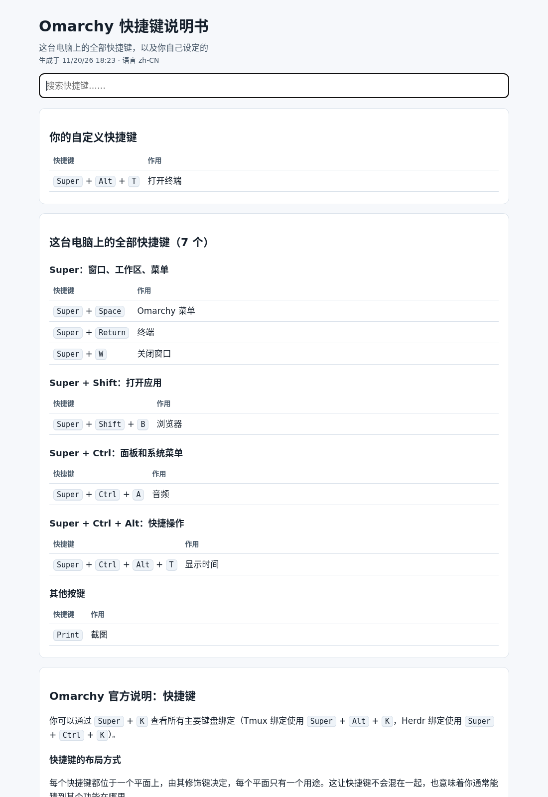

# Omarchy_Hotkeys

[Omarchy](https://omarchy.org) 的快捷键说明书和自定义快捷键工具，界面跟随系统语言。



## 它能做什么

- 快捷键说明书：一个网页，列出这台电脑上正在生效的全部快捷键（包括你自己设定的），按用途分组，可以搜索、打印、另存为 PDF；下面附上 Omarchy 官方的快捷键说明。
- 自定义快捷键：一步一步地添加快捷键、替换 Omarchy 默认的快捷键、关闭不想要的快捷键，冲突时会提醒你。
- 跟随系统语言：用 Omarchy 设置里选的语言（设置 → 区域 → 语言）。快捷键的说明文字直接用 Omarchy 自己的翻译，支持全部 50 种语言；本工具自己的文字有简体中文、繁體中文和英文，其他语言显示英文。

## 安装

在 Omarchy 里按 `Super + Enter` 打开终端，粘贴：

```bash
curl -fsSL https://raw.githubusercontent.com/Freecode100Year/Omarchy_Hotkeys/main/install.sh | bash
```

连不上 GitHub 时：

```bash
curl -fsSL https://gitlab.com/sj9292008133/Omarchy_Hotkeys/-/raw/main/install.sh | bash
```

不需要 `sudo`。装好后，在应用启动器（`Super + Space`）里搜索：

- 「快捷键说明书」：打开说明书
- 「自定义快捷键」：添加、删除、关闭快捷键

## 命令行

```bash
omarchy-hotkeys manual                                   # 生成并打开说明书
omarchy-hotkeys menu                                     # 一步一步设定快捷键
omarchy-hotkeys add "SUPER + ALT + T" "打开终端" "ghostty" # 添加
omarchy-hotkeys add "SUPER + SHIFT + B" "火狐" "firefox" --force   # 替换已有的快捷键
omarchy-hotkeys disable "SUPER + SHIFT + B"              # 关闭一个默认快捷键
omarchy-hotkeys remove "SUPER + ALT + T"                 # 删除自己的，或恢复被关闭的默认快捷键
omarchy-hotkeys list                                     # 看自己设定的快捷键
omarchy-hotkeys edit                                     # 直接编辑设置文件，改完运行 omarchy-hotkeys apply
```

按键写法：`SUPER`、`CTRL`、`ALT`、`SHIFT` 加一个键，用 `+` 连接，大小写都可以。新设的快捷键会出现在 Omarchy 的快捷键菜单（`Super + K`）里。

## 设置放在哪里

| 位置 | 内容 |
|---|---|
| `~/.config/omarchy-hotkeys/hotkeys.conf` | 你的快捷键，每行一个：`快捷键 \| 说明 \| 命令`，或 `快捷键 \| disable` |
| `~/.local/state/omarchy/toggles/hypr/zz-omarchy-hotkeys.lua` | 由上面的文件生成。Omarchy 会在自己的快捷键之后读取这个文件夹，所以不改 Omarchy 和 `~/.config/hypr` 里的任何文件 |
| `~/.local/share/omarchy-hotkeys/manual-<语言>.html` | 生成的说明书 |

卸载：`omarchy-hotkeys uninstall`。你的 `hotkeys.conf` 会保留，重新安装后快捷键自动恢复。

## 说明

- 想按 Omarchy 的规矩选快捷键：系统功能用 `Super + 键`，打开应用用 `Super + Shift + 键`，面板用 `Super + Ctrl + 键`，快捷操作用 `Super + Ctrl + Alt + 键`；说明书里的官方说明有详细解释。
- 添加时如果这个组合已经有用途，会告诉你原来是做什么的，确认后才替换。
- 开发：`bash tests/cli_test.sh`（用模拟的 Omarchy 环境测试全部功能和三种语言）。

MIT 许可证。

---

## English

Hotkey manual and custom hotkeys for Omarchy, in the system language. The manual lists every shortcut active on this computer (yours included), grouped by plane, searchable and printable, followed by Omarchy's own hotkeys chapter. Binding descriptions use Omarchy's translations (all 50 languages); this tool's own words are in English, Simplified and Traditional Chinese.

```bash
curl -fsSL https://raw.githubusercontent.com/Freecode100Year/Omarchy_Hotkeys/main/install.sh | bash
omarchy-hotkeys manual | menu | add "<keys>" "<label>" "<command>" [--force] | disable "<keys>" | remove "<keys>" | list
```

Custom hotkeys live in `~/.config/omarchy-hotkeys/hotkeys.conf` and are applied through Omarchy's toggles folder, so no Omarchy or `~/.config/hypr` file is edited.
